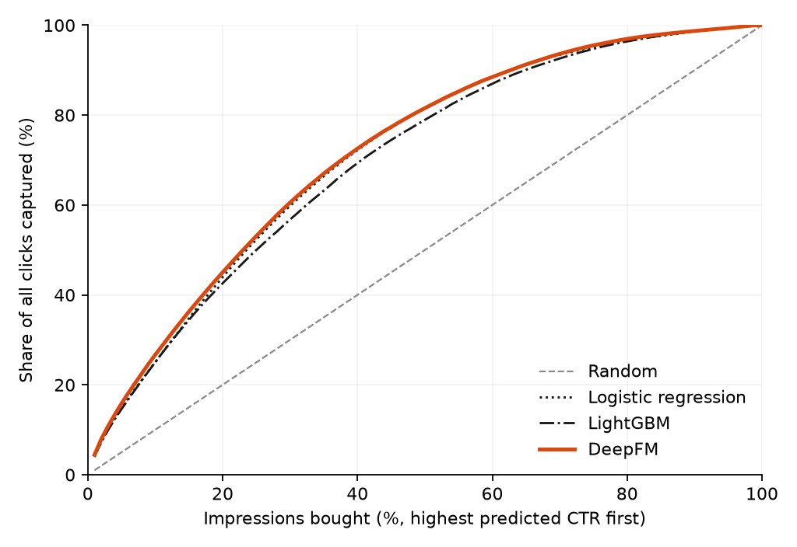

# Ad click prediction on 2014 Avazu data

Click prediction is the same task Google Ads and every ad platform solve. This repo does it on public 2014 Avazu mobile display data, and it is not Google's system or data. I trained logistic regression, LightGBM and DeepFM on an 8 GB M3 MacBook Air and scored them on 2 million held-out impressions.

Takeaway: buying the top 10% of impressions ranked by DeepFM captures 26.7% of all clicks, 2.67 times what random buying gets in expectation. The simple model comes close to the neural net, so it deserves a fair fight.

Caveats: one run, no confidence intervals, and DeepFM was picked as the headline model by its test clicks at the 10% budget (see Method notes). Raw counts are in the results table.

## Results

Scored once on the held-out test split (1,998,311 impressions, 304,478 clicks). Higher AUC is better, lower log loss is better. "Gain" is how much the model beats a constant guess of the train click rate.

| Model | AUC | Log loss | Gain over constant | Clicks in top 10% | Train time |
|---|---|---|---|---|---|
| DeepFM (PyTorch, MPS) | 0.7566 | 0.3699 | 13.7% | 81,210 (26.7%) | 375 s |
| Logistic regression | 0.7509 | 0.3737 | 12.8% | 76,177 (25.0%) | 1,672 s |
| LightGBM | 0.7365 | 0.3793 | 11.5% | 76,194 (25.0%) | 95 s |
| Random buying (expected) | n/a | n/a | n/a | 30,448 (10.0%) | n/a |

Random buying is an expected value (total test clicks times the budget share), not a simulated draw. Constant-guess log loss is 0.4287. Logistic regression train time is the final fit at the chosen C. The whole three-value search took 4,091 s. DeepFM ran on the MPS GPU and the other two on CPU, and logistic regression used the liblinear solver and was not optimised for speed, so these times are not a ranking of model speed.

DeepFM's best validation AUC was 0.7417 (epoch 1, `logs/deepfm.log`) while its test AUC is 0.7566. The splits differ in click rate (17.5% train, 16.8% valid, 15.2% test), and I did not investigate this gap.



If I can only afford to show an ad on X% of impressions, how many clicks do I keep? Rank every impression by predicted click probability, buy from the top. At a 20% budget DeepFM keeps 45.0% of clicks, logistic regression 43.9%, LightGBM 42.6%. At 50% they keep 81.6%, 81.5% and 78.9%.

On test, DeepFM leads, by a small margin over a logistic regression whose regularisation was only lightly tuned (its best C sat at the edge of the grid, see limitations). The gap to LightGBM is bigger, and I did not tune LightGBM much either.

## Run it yourself

Needs macOS on Apple silicon, Python 3.11, [uv](https://docs.astral.sh/uv/), and Homebrew's OpenMP runtime for LightGBM (`brew install libomp`. The lightgbm wheel does not bundle it, so `src/train_lgbm.py` fails at import without it). Data prep needs about 625 MB for the download plus about 177 MB for the three parquet files (`data/avazu.zip` is kept after prep and can be deleted once the parquet files exist).

```bash
cd ctr-lab
brew install libomp
uv venv --python 3.11
source .venv/bin/activate
uv pip install numpy==2.4.6 pandas==3.1.1 scipy==1.17.1 scikit-learn==1.9.1 pyarrow==26.0.1 lightgbm==4.7.0 torch==2.15.0 matplotlib==3.11.2

mkdir -p logs
.venv/bin/python src/prepare_data.py     # downloads Avazu_x1 (625 MB), samples it, writes data/*.parquet
/usr/bin/time -l .venv/bin/python src/train_logreg.py > logs/logreg.log 2> logs/logreg.time   # searches C on the valid split, scores test once
/usr/bin/time -l .venv/bin/python src/train_lgbm.py > logs/lgbm.log 2> logs/lgbm.time
/usr/bin/time -l .venv/bin/python src/train_deepfm.py > logs/deepfm.log 2> logs/deepfm.time   # uses Apple MPS if available
.venv/bin/python src/evaluate.py         # writes results/summary.json and results/budget_curve.png
.venv/bin/python dashboard/build.py      # builds dashboard/index.html
```

Versions above are the ones I ran. A rerun may not reproduce the published digits exactly: DeepFM runs on MPS, which is not bitwise deterministic, and thread scheduling can shift LightGBM and the logistic regression solver slightly. Expect the same ranking story, not identical decimals.

Each training script accepts `--limit N` to run on N rows per split as a quick smoke test. Warning: a `--limit` run overwrites `results/<model>.json` and `results/preds_<model>.npy` with smoke-test output, so rerun the full training script before `evaluate.py`.

Memory: the peak figures in `logs/*.time` are the "peak memory footprint" field of `/usr/bin/time -l` (bytes, read as decimal GB): about 7.6 GB for logistic regression, 6.6 GB for DeepFM and 5.6 GB for LightGBM. That is a different number from "maximum resident set size" (about 2.0 GB for logistic regression), so do not mix them. On 8 GB there is little headroom.

Sources: metrics, click counts, timings, split sizes and click rates come from `results/*.json` and `results/summary.json`. Memory figures and per-epoch DeepFM valid AUC come from `logs/`. The field count and DeepFM hyperparameters come from `src/`. Mean predicted click rates in the limitations are averages of the calibration bins in `results/summary.json`.

## Method notes

- Data: a uniform random sample (seed 42) of each reczoo/Avazu_x1 split. Train 7,998,480, valid 1,001,170, test 1,998,311 impressions, 22 anonymised fields.
- Split drift is real and I kept it. Click rate is 17.5% in train, 16.8% in valid and 15.2% in test. The drift sits in the source split. I did not test its cause, or how closely it resembles live traffic.
- Encoding: each field maps raw ids to contiguous indices, fitted on train only. Ids seen fewer than twice, and ids never seen in train, share one bucket.
- Logistic regression: L2, sparse one-hot. C chosen on valid log loss from [0.001, 0.003, 0.01].
- LightGBM: fields with up to 1,000 distinct values are treated as categorical, and every field also gets a count-encoding feature. Early stopping on valid log loss. The best iteration was 225.
- DeepFM: 16-dimensional embeddings shared by the factorisation-machine and deep parts, a 256 and 128 hidden MLP, dropout 0.2, Adam at 1e-3. Early stopping on valid AUC with zero patience, best epoch was 1 of 2 run. 14,007,328 parameters.
- Test labels are scored once per model, and every hyperparameter and stopping choice (C, early stopping, best epoch) was made on valid. The exception is the headline pick: DeepFM was chosen as the headline model by its test clicks at the 10% budget (`src/evaluate.py`). I did not store valid metrics for all three models in `results/`, so I cannot show from the stored results that DeepFM also leads on valid. The logs show valid log loss for logistic regression and LightGBM and valid AUC for DeepFM only, which are not comparable across models.
- Evaluation: AUC and log loss, plus the budget curve above, which is the number a media buyer can act on.

## Limitations

- Logistic regression's best C (0.01) sat at the top edge of the grid I tried, so it is probably slightly under-tuned and is not a fully tuned baseline. A larger C could close or flip part of the gap to DeepFM.
- LightGBM ran with one parameter set and early stopping, no search. Its lower rank here says little about tree models in general.
- DeepFM trained for two epochs and was stopped at the first drop in valid AUC. One seed, no confidence intervals. The 0.0057 AUC lead over logistic regression comes from a single run and is unproven.
- Calibration is off, which is consistent with a test split that has a lower click rate than train, though I did not test the drift as the cause. Mean predicted click rate on test is 16.4% (logistic regression), 16.3% (LightGBM) and 16.1% (DeepFM) against an actual 15.2%. Ranking, which the budget curve measures, is less affected than predicted probabilities, so do not read these outputs as true click rates without recalibrating.
- Rows are a sample of the original dataset, and the fields are anonymised, so I did no feature engineering from domain knowledge. No time-of-day, device or placement analysis.
- Avazu is 2014 mobile display data, so it is only a rough proxy for current ad auctions.
- There is no money in this analysis: it has no bids, costs or conversions, only clicks. Turning clicks into cost or return needs a price per impression and a value per click, and I have no real figures for either.

## Data credit and licence

Data: [reczoo/Avazu_x1](https://huggingface.co/datasets/reczoo/Avazu_x1) on Hugging Face, derived from the Kaggle Avazu click-through rate prediction challenge (2014). All credit for the data goes to Avazu, Kaggle and the reczoo maintainers.

The raw data is not redistributed in this repository. `src/prepare_data.py` downloads it from the source and rebuilds the sample, so check the dataset's own terms before reusing it.

The code in this repository is released under the [MIT licence](LICENSE). The licence covers the code only. It does not cover the Avazu data, which stays under its original terms.

Built by Sai Kanagat, Bologna.
